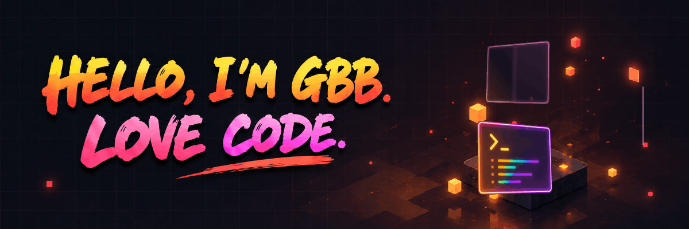

  

  

  <a href="#精选项目">精选项目</a> ·
  <a href="#关于我">关于我</a> ·
  <a href="#记录与分享">记录与分享</a> ·
  <a href="#代码足迹">代码足迹</a> ·
  <a href="https://github.com/zzugbb?tab=repositories">全部仓库 ↗</a>

## 你好，我是 GBB。

以前端开发为主，持续探索 AI。喜欢把想法做成能用、能体验的作品。

## 精选项目

<table>
<tr>
<td width="50%" valign="top">

<h3><a href="https://github.com/zzugbb/InsightAgent">InsightAgent</a></h3>

<strong>可视化、可解释的 AI Agent 工作台</strong>

知识检索 · 工具执行 · 轨迹复核

<a href="https://github.com/zzugbb/InsightAgent">仓库 ↗</a> · <a href="https://zzugbb.github.io/InsightAgent/">在线展示 ↗</a> · <a href="https://github.com/zzugbb/InsightAgent#项目演示">演示视频 ↗</a>

</td>
<td width="50%" valign="top">

<h3><a href="https://github.com/zzugbb/KVM-Recon">KVM-Recon</a></h3>

<strong>BMC / HTML5 KVM 离线证据采集</strong>

原始事实 · 完整度检查 · 校验导出

<a href="https://github.com/zzugbb/KVM-Recon">仓库 ↗</a> · <a href="https://zzugbb.github.io/KVM-Recon/">在线展示 ↗</a> · <a href="https://github.com/zzugbb/KVM-Recon#项目演示">演示视频 ↗</a>

</td>
</tr>
</table>

## 关于我

喜欢尝试不同类型的项目，也记录过程中的实践与思考。在这里分享代码、作品和用过的实用资源。

   &nbsp;
   &nbsp;
   &nbsp;
   &nbsp;
   &nbsp;
  

## 记录与分享

<table>
<tr>
<td width="50%" valign="top">

<h3><a href="https://github.com/zzugbb/awesome-my-website">收藏导航</a></h3>

把用过的好网站，放在一起。

<a href="https://zzugbb.github.io/awesome-my-website/">访问网站 ↗</a> · <a href="https://github.com/zzugbb/awesome-my-website">仓库 ↗</a>

</td>
<td width="50%" valign="top">

<h3><a href="https://github.com/zzugbb/zzugbb.github.io">个人博客</a></h3>

留下实践、学习与思考的记录。

<a href="https://zzugbb.github.io/">访问博客 ↗</a> · <a href="https://github.com/zzugbb/zzugbb.github.io">仓库 ↗</a>

</td>
</tr>
</table>

## 代码足迹

  
  

  <picture>
    <source media="(prefers-color-scheme: light)" srcset="asset/contributions-light.svg">
    
  </picture>

---

  最困难的事情就是认识自己。 
  GBB · Love Code

  欢迎交流前端开发、AI 应用与有趣的项目。<a href="https://github.com/zzugbb/InsightAgent/issues">项目交流 ↗</a>

